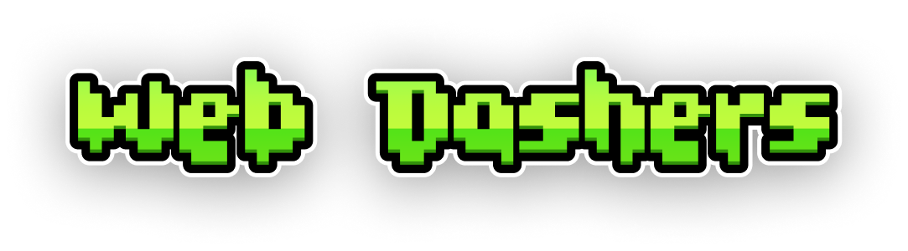

> [!NOTE]
> This project is still in development and is not complete. Report bugs on the Discord server (`#bug-report` forum) or the Issues page on this repository. Thank you for your support!

  
  

  <strong>A modded Geometry Dash demo with extra features added!</strong>
  

  
  &nbsp;
  

---

## Features

- **Main levels:** 38 built-in main levels, including hidden and vault-only levels, served from `assets/scripts/game/allLevels.js`.
- **Online levels:** play levels from the server, and create and upload your own. Level search lives in the menu.
- **Level editor:** build levels with placeable objects, grid tools, swipe placement, and playtesting. Image blocks can be animated GIFs, with frame-speed control.
- **Accounts and cloud saves:** register, log in, and sync your save data to the server (`assets/scripts/api/`).
- **TailsConnect:** multiplayer transport and UI, opened from the menu (`assets/scripts/core/tails-connect.js`).
- **Coins and achievements:** coin economy and achievement tracking (`coin-economy.js`, `achievements.js`).
- **Game modes:** most Geometry Dash modes are implemented. Swing is not.
- **Icon Kit:** choose icons and colors for your player. Icons from 2.2 are not included yet.
- **Settings and V3 feature menu:** a searchable native Phaser menu with per-feature toggles, saved locally. Open it from Settings, or press `Ctrl+Shift+P`.
- **Music:** GD World songs are available in the editor.

## Known issues

- **Practice Mode** works in an early form. Bugs remain.
- **Level Editor** is missing many Geometry Dash objects and features.
- **Some objects** lack animations or have incorrect colors.

## Development

- `npm start` serves the client locally with `npx serve .`.
- There is no automated test suite. Test affected flows in a browser: menus, editor save and load, normal and practice play, and gravity or dual mode when relevant.
- Syntax checks: `node --check` on changed JavaScript files, and `bash -n` on the level scripts in `scripts/`.
- Level tools: see `scripts/README.md` before registering main levels.
- Contributor and style rules are in `AGENTS.md`.

## Play

**[web-dashers.github.io](https://web-dashers.github.io/)**

Last updated: 11/11/2026

---
> - Thanks to everyone who contributes, and please star the repo if you enjoy the project.
> - Report bugs on the Discord or the Issues page. Please check existing reports first.
